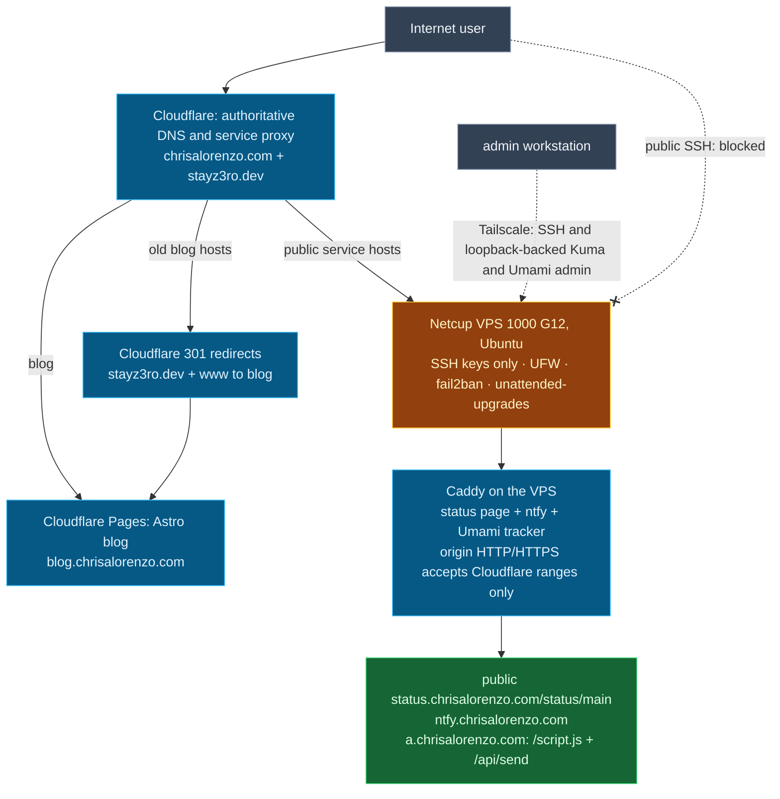

# VPS Cloud Infra: Architecture Overview

One consolidated view of the recorded architecture as of 2026-10-14. The phase diagrams
([phase 1](phase-1-vps-baseline-security.md),
[phase 2](phase-2-domain-dns-public-routing.md),
[phase 3](phase-3-reverse-proxy-https.md)) carry the detail.

Cloudflare is authoritative for both zones; Porkbun remains the registrar for
`stayz3ro.dev`. The blog runs on Cloudflare Pages at
`blog.chrisalorenzo.com`, while the old apex and `www` return 301 to it.
`status.stayz3ro.dev` returns 301 to the new status host. Caddy serves
the public status page at `status.chrisalorenzo.com/status/main`, ntfy at
`ntfy.chrisalorenzo.com`, and Umami tracker paths at `a.chrisalorenzo.com`.
Kuma admin and other Umami paths return 404 on the public hosts. Kuma admin
uses loopback port 3001 through Tailscale Serve on 8443; Umami admin uses
loopback port 3000 through Tailscale Serve on 8444. PostgreSQL has no
published port.

Since 2026-10-05, service records are proxied and origin HTTP/HTTPS accepts
Cloudflare ranges only, including Docker-published Caddy ports through
`DOCKER-USER`. The Umami deployment and proxied-record correction were
recorded on 2026-10-14 in [CHANGELOG.md](../CHANGELOG.md#2026-10-14-umami-deployed-public-record-proxied).
[Current Status](../CURRENT-STATUS.md) owns remaining evidence and integration
checks; [ROADMAP.md](../ROADMAP.md) owns planned backup and secondary VPS work.
